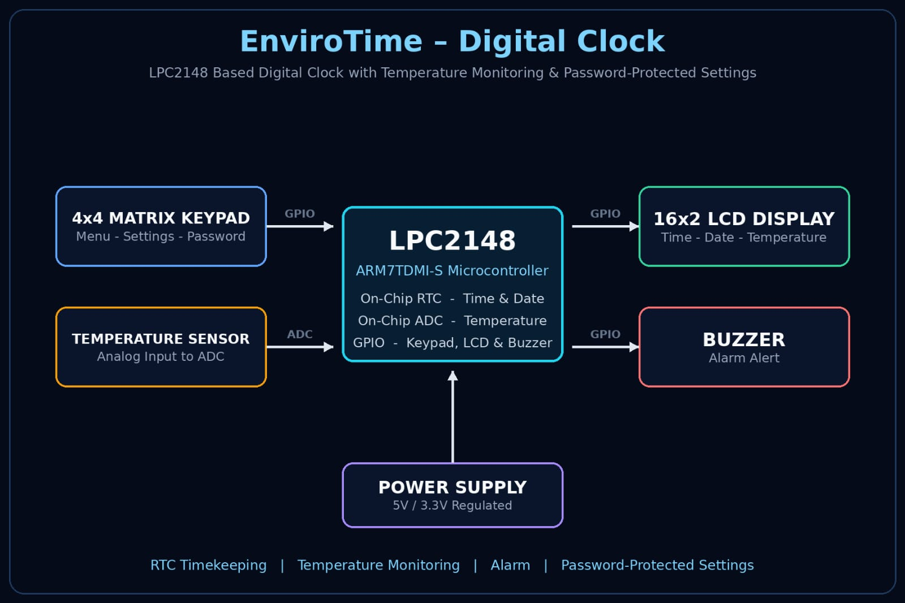

# EnviroTime – Digital Clock ⏰🌡️

An *LPC2148 (ARM7)-based digital clock* with real-time temperature monitoring and password-protected settings.

## 📌 Overview

EnviroTime displays the current time and date on an LCD using the LPC2148's on-chip RTC, continuously monitors the surrounding temperature, and provides an alarm feature. All settings are accessed through a keypad-driven menu that is protected by a password, so only authorized users can change the time, alarm, or configuration.

## 🖼️ Block Diagram

## ✨ Features

- 🕐 Real-time clock (hours, minutes, seconds) with date display
- 🌡️ Live temperature monitoring and display
- ⏰ Alarm with settable alarm time
- 🔐 Password-protected settings menu
- ⌨️ 4×4 keypad for input and navigation
- 📟 LCD display with a simple menu-driven interface

## 🛠️ Hardware Used

- LPC2148 microcontroller (ARM7TDMI-S)
- 16×2 LCD display
- 4×4 matrix keypad
- Temperature sensor

## 💻 Software

- Embedded C
- Keil µVision IDE

## 📂 File Structure

| File | Description |
|------|-------------|
| main.c | Main application logic |
| rtc.c / rtc.h | RTC setup and timekeeping |
| temperature.c / temperature.h | Temperature sensing and conversion |
| lcd.c / lcd.h | LCD display driver |
| keypad.c / keypad.h | Keypad scanning and key detection |
| menu.c / menu.h | Settings menu handling |
| password.c / password.h | Password verification for settings access |
| alarm.c / alarm.h | Alarm functionality |
| delay.c / delay.h | Delay functions |
| pin_config.h | Pin definitions and configuration |

## ⚙️ How It Works

1. The RTC keeps track of time and date continuously.
2. The LCD displays the time along with the current temperature.
3. Pressing a key opens the menu — a password is required to enter settings.
4. Using the keypad, the user can set the time, date, and alarm.
5. When the clock time matches the alarm time, the alarm is triggered.

## 👩‍💻 Author
Samreen
